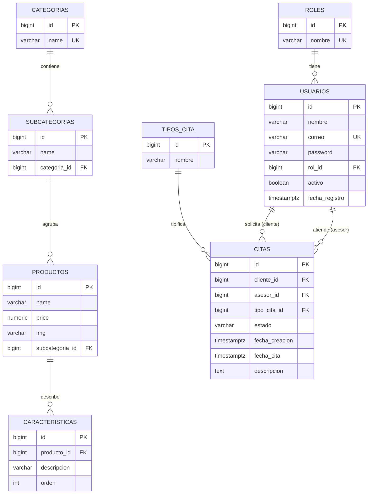

# 02 — Modelo de datos

## Objetivo
Definir el modelo relacional de SERVITEC en PostgreSQL: entidades, columnas, tipos, restricciones y
relaciones, junto con el mapeo desde el modelo MongoDB heredado y las reglas de integridad.

## Alcance
Entidades: `roles`, `usuarios`, `categorias`, `subcategorias`, `productos`, `caracteristicas`,
`tipos_cita`, `citas`. Incluye claves, índices, restricciones `CHECK` y datos semilla.

## Diagrama ER

## Diccionario de datos

### `roles`
| Columna | Tipo | Restricciones | Descripción |
|---|---|---|---|
| `id` | `bigint` | PK, identity | |
| `nombre` | `varchar(20)` | NOT NULL, UNIQUE | `admin`, `asesor`, `cliente` |
| `descripcion` | `varchar(120)` | | Texto de apoyo |

Semilla: `1=admin`, `2=asesor`, `3=cliente`.

### `usuarios`
| Columna | Tipo | Restricciones | Descripción |
|---|---|---|---|
| `id` | `bigint` | PK, identity | |
| `nombre` | `varchar(120)` | NOT NULL | |
| `correo` | `varchar(150)` | NOT NULL, UNIQUE | Clave de login |
| `password` | `varchar(100)` | NOT NULL | Hash BCrypt (nunca se serializa) |
| `rol_id` | `bigint` | NOT NULL, FK → `roles(id)` | |
| `activo` | `boolean` | NOT NULL, DEFAULT `true` | Borrado lógico |
| `fecha_registro` | `timestamptz` | NOT NULL, DEFAULT `now()` | |

### `categorias`
| Columna | Tipo | Restricciones |
|---|---|---|
| `id` | `bigint` | PK, **sin identity** (IDs 1–3 de la semilla) |
| `name` | `varchar(60)` | NOT NULL, UNIQUE |

### `subcategorias`
| Columna | Tipo | Restricciones |
|---|---|---|
| `id` | `bigint` | PK, sin identity (101–112) |
| `name` | `varchar(60)` | NOT NULL |
| `categoria_id` | `bigint` | NOT NULL, FK → `categorias(id)` |
| | | UNIQUE `(categoria_id, name)` |

### `productos`
| Columna | Tipo | Restricciones |
|---|---|---|
| `id` | `bigint` | PK, sin identity (1–60) |
| `name` | `varchar(150)` | NOT NULL |
| `price` | `numeric(10,2)` | NOT NULL, CHECK `price >= 0` |
| `img` | `varchar(500)` | |
| `subcategoria_id` | `bigint` | NOT NULL, FK → `subcategorias(id)` |

> La categoría **no** se duplica en `productos`; se deriva por `subcategoria_id → subcategorias.categoria_id`.

### `caracteristicas`
| Columna | Tipo | Restricciones |
|---|---|---|
| `id` | `bigint` | PK, identity |
| `producto_id` | `bigint` | NOT NULL, FK → `productos(id)` ON DELETE CASCADE |
| `descripcion` | `varchar(300)` | NOT NULL |
| `orden` | `int` | NOT NULL, DEFAULT 0 |

### `tipos_cita`
| Columna | Tipo | Restricciones |
|---|---|---|
| `id` | `bigint` | PK, sin identity (1–2) |
| `nombre` | `varchar(30)` | NOT NULL, UNIQUE |

> La columna es `nombre`, pero el JSON expone el campo legado **`type`** (`@JsonProperty("type")`).
> Semilla: `1=Presencial`, `2=Virtual`.

### `citas`
| Columna | Tipo | Restricciones |
|---|---|---|
| `id` | `bigint` | PK, identity |
| `cliente_id` | `bigint` | NOT NULL, FK → `usuarios(id)` |
| `asesor_id` | `bigint` | NOT NULL, FK → `usuarios(id)` |
| `tipo_cita_id` | `bigint` | NOT NULL, FK → `tipos_cita(id)` |
| `estado` | `varchar(20)` | NOT NULL, DEFAULT `'Pendiente'`, CHECK `estado IN ('Pendiente','Realizada','Cancelada')` |
| `fecha_creacion` | `timestamptz` | NOT NULL, DEFAULT `now()` |
| `fecha_cita` | `timestamptz` | NOT NULL |
| `descripcion` | `text` | |

Índices y restricciones:
- `UNIQUE (asesor_id, fecha_cita) WHERE estado <> 'Cancelada'` → **regla R-3** (HU-07).
- `INDEX (cliente_id)`, `INDEX (asesor_id)`, `INDEX (fecha_cita)`.

## Reglas e integridad
- Todas las PK son `BIGINT`; el catálogo conserva sus IDs originales.
- Sin `ON DELETE` en las FKs de `citas` y `productos` (borrado restringido): integridad referencial dura.
- `caracteristicas` se elimina en cascada con su producto.
- Cancelar una cita **nunca** borra la fila (R-2).

## Mapeo desde el modelo MongoDB heredado
| Mongo | PostgreSQL | Nota |
|---|---|---|
| `categorias._id` (int) | `categorias.id` | Se conserva |
| `subcategorias.categoriaId` | `subcategorias.categoria_id` | |
| `productos.categoriaId` | *(eliminado)* | Redundante: se deriva por subcategoría |
| `productos.description[]` | `caracteristicas(descripcion, orden)` | Array → tabla hija |
| `usuarios._id` (ObjectId) | `usuarios.id` (bigint) | FKs remapeadas en la semilla |
| `usuarios.rol` (string) | `usuarios.rol_id` → `roles` | `admin`/`cliente` → +`asesor` |
| `usuarios.citas[]` | *(eliminado)* | Redundante: relación por `citas.cliente_id` |
| `tiposCitas.type` | `tipos_cita.nombre` (JSON: `type`) | |
| `citas.estado` (`Realizada`/`cancelado`) | `citas.estado` (CHECK) | Normalizado a `Pendiente/Realizada/Cancelada` |
| `citas.fechaCita` (Date) | `citas.fecha_cita` (timestamptz UTC) | |

## Datos semilla (repetible)
- 3 categorías, 12 subcategorías, 60 productos + sus características, 2 tipos de cita.
- Usuarios demo con correos `@servitec.pe` (admin, asesor, cliente) y credenciales documentadas en `07-install-guide.md`.
- Unas pocas citas cubriendo los tres estados.

## Criterios de aceptación
- **P06** — el catálogo consultado por categoría coincide exactamente con las filas de `productos`.
- Todo `producto` tiene `subcategoria_id` válido; toda `cita` tiene cliente, asesor y tipo válidos.
- Intentar insertar dos citas no canceladas del mismo asesor en el mismo instante **falla a nivel de BD**.

## Tareas derivables
1. Escribir las migraciones `V1__esquema_inicial.sql` (tablas, FKs, checks) y los índices de `citas`.
2. Escribir la migración de catálogo y la semilla idempotente `R__seed_*.sql`.
3. Mapear entidades JPA (`Usuario`, `Rol`, `Categoria`, `Subcategoria`, `Producto`, `Caracteristica`, `TipoCita`, `Cita`).
4. Verificar el índice único parcial con una prueba de integración.

## Dependencias
- Convenciones de migración: `05-db-migrations.md`.
- Reglas de negocio: `01-functional.md`.
- Exposición JSON: `03-api-contract.md`.

## Evidencia esperada
- Scripts `V#__*.sql` / `R__*.sql` aplicados sin error.
- Salida de `\d citas` mostrando el índice único parcial.
- Volcado de conteos de semilla (3/12/60/2).
